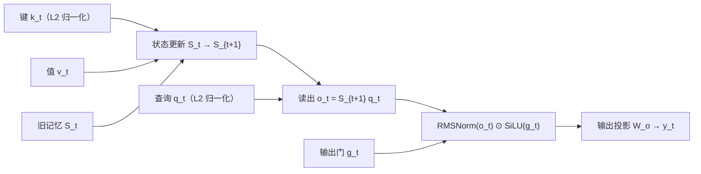

这几天看了些许 Linear Attention 和 Pretrain Optimizer 的工作。仔细想想可以发现一些有趣的联系，一个人花了一天多时间仔细研究，得到了一些有趣的结论，也留下了一些开放的问题。希望可以给大家带来一点 insight。

我们不妨从几乎所有现代线性注意力模块都已经默认做出的四个假设出发：

1. $$k$$ 是 normalize 过的；
2. $$q$$ 是 normalize 过的；
3. $$o = S q$$，且 $$o$$ 在被任何后续操作碰到之前，都会先经过一次归一化（RMSNorm）；
4. 我们可以把 Linear Attention 看作 Test-Time Training（TTT）——沿着 [Sun et al. (2024)](https://arxiv.org/abs/2407.04620) 的思路，以及把线性注意力、DeltaNet、各种门控和关联记忆都收进同一套测试时回归 / 在线优化框架的经典工作（如 [Wang et al. (2025)](https://arxiv.org/abs/2501.12352) 的 *Test-Time Regression* 与 [Behrouz et al. (2025)](https://arxiv.org/abs/2504.13173) 的 *MIRAS*）。

在阅读了 Kaiyue Wen（[Hyperball Optimization](https://arxiv.org/abs/2606.16899)）和苏剑林（[《从参数对称性到有效学习率》](https://spaces.ac.cn/archives/11985)）关于优化器与有效学习率的分享之后，一个很有意思的问题就会自然而然地冒出来：既然 Linear Attention 的 Test-Time *Training* 名字里也带了一个 *training*，那**它内部的优化器究竟长什么样？**进一步地，Linear Attention 这个模块本身的特殊结构，能否提示我们一种更好、或者至少更本质的优化策略？

这篇文章并不打算提出什么新架构，它想提供的只是**一个视角**。仅从上面这四个假设出发，我们会发现 [DeltaNet](https://arxiv.org/abs/2406.06484)、[Gated DeltaNet](https://arxiv.org/abs/2412.06464) 以及几类校准/齐次变体，其实都是对同一个小问题的不同回答。

---

## 1. 设定（Setup）

现代线性注意力的单步流程通常是这样的：



具体来说，记忆是一个矩阵 $$S_t \in \mathbb{R}^{d_v \times d_k}$$。在每一步，我们看到一对 $$(k_t, v_t)$$，更新记忆，再用 $$q_t$$ 读出：

$$
S_{t+1} = S_t - \beta_t (S_t k_t - v_t) k_t^\top, \qquad
o_t = S_{t+1} q_t, \qquad
y_t = W_o\big[\mathrm{RMSNorm}(o_t) \odot \mathrm{SiLU}(g_t)\big]. \tag{1}
$$

式 (1) 恰好就是单步回归损失 $$\frac{1}{2}\|S k_t - v_t\|_2^2$$ 上的一步 SGD。这就是 TTT 的视角（也是前面那些统一框架的核心读法）：“内层模型”是线性映射 $$S$$，“训练数据”是不断到来的 $$(k_t, v_t)$$ 数据流，而“内层优化器”就是步长为 $$\beta_t$$ 的 SGD。

下文会用到几个记号：键的二阶矩 $$\Sigma = \mathbb{E}[k k^\top] \succ 0$$，键值互相关 $$C = \mathbb{E}[v k^\top]$$，最小二乘最优解 $$P^* = C \Sigma^{-1}$$，旧预测 $$p_t = S_t k_t$$，以及矩阵 Frobenius 归一化算子 $$N_F(X) = X / \|X\|_F$$。

---

## 2. $$q$$ 和 $$k$$ 的关系

有一件事我一直觉得挺神奇：我们到底该怎么理解 $$q$$？

常见的说法是：$$S$$ *就是*记忆，$$S k \approx v$$ 意味着它记住了某些东西，而 $$q$$ 是一个测试向量，用来把记忆读出来。仔细想想这其实有点玄妙——在普通的 Softmax Attention 里，我们往往觉得 $$q$$ 和 $$k$$ 未必真正“活在同一个线性空间里”；但在这里，我们用 $$k$$ 写入、用 $$q$$ 通过**同一个线性映射**读出，居然就 work 了。

再多想一层，你会发现写入和读出这两端甚至连优化目标都不一样。

对于一对 $$(k, v)$$，我们希望 $$S k$$ 尽可能贴近 $$v$$。具体写出来就是：

$$
\min_S \;\; \mathbb{E}\,\|S k - v\|_2^2. \tag{2}
$$

而对于一对 $$(q, o)$$（这里 $$o$$ 既代表 *oracle* 又代表 *output*，笑），我们真正关心的其实是输出**有没有指对方向**——因为紧接着发生在 $$o_t$$ 身上的第一件事就是 RMSNorm，它会直接把长度扔掉：

$$
\max_S \;\; \mathrm{sim}(S q,\; o^\star). \tag{3}
$$

式 (3) 里的“最大化相似度”可以写成很多等价形式：

- 余弦相似度：$$\max\; \cos\angle(S q,\; o^\star)$$；
- 归一化距离：$$\min\; \|\mathrm{RMSNorm}(S q) - \mathrm{RMSNorm}(o^\star)\|_2^2$$；
- 或者任何只依赖于射线 $$\{a\, S q : a > 0\}$$ 的目标函数。

假设我们达成了式 (2)，并且也认同 $$(q, o)$$ 在某种意义上就是另一组 $$(k, v)$$（即理想读出满足 $$o^\star = P^* q$$），那么把式 (2) 训好，自然会推导出式 (3)。

反过来呢？式 (2) 显然太强了：式 (3) 根本不在乎输出乘上任何正标量。直觉上，每个查询似乎都可以接受各自不同的缩放因子。但这并不意味着我们没法从式 (3) 往回推。

> **旁注（假设 2 其实是白送的）。** 因为 $$o_t = S_{t+1} q_t$$ 关于 $$q_t$$ 是线性的，而理想 RMSNorm（$$\varepsilon \to 0$$）对任意 $$a > 0$$ 满足 $$\mathrm{RMSNorm}(a\, o) = \mathrm{RMSNorm}(o)$$，所以给 $$q$$ 做归一化只是把 $$o$$ 乘上了一个正标量，紧接着就被 RMSNorm 吃掉了。在理想输出归一化下，对 $$q$$ 做归一化在前向和反向传播中都是冗余的。相比之下，对 $$k$$ 做归一化完全是另一回事，我们马上就会看到。

---

## 3. 一个引理：你只拥有一个全局尺度

每条记忆真的能各自挑一个尺度吗？给一个两秒钟的反例。取两个正交的键 $$k_1 \perp k_2$$，把它们按不同倍数存进记忆：

$$
S k_1 = 2 v_1, \qquad S k_2 = 1 \cdot v_2. \tag{4}
$$

单独拿 $$k_1$$ 或 $$k_2$$ 来查，读出来的方向全都对。但现在问一个混合查询 $$q = \frac{1}{\sqrt{2}}(k_1 + k_2)$$：理想输出应该沿着 $$v_1 + v_2$$ 的方向，可按式 (4) 实际读出来的是 $$2 v_1 + v_2$$。**方向错了。** 只要查询一混合，逐记忆的尺度差异就会立刻泄漏成方向误差。

这绝非巧合：

> **引理（射影唯一性）。** 设 $$\operatorname{rank}(M) \ge 2$$。如果对所有 $$q \notin \ker M$$，向量 $$S q$$ 都是 $$M q$$ 的正标量倍，那么必定存在唯一的全局常数 $$c > 0$$，使得 $$S = c M$$。

<details markdown="1">
<summary>展开查看：射影唯一性引理的证明</summary>

记 $$S q = c(q)\, M q$$。若 $$M q_1, M q_2$$ 线性无关，由线性性得：

$$
c(q_1 + q_2)(M q_1 + M q_2) = S(q_1 + q_2) = c(q_1) M q_1 + c(q_2) M q_2,
$$

比较系数即得 $$c(q_1) = c(q_2) = c(q_1 + q_2)$$。若 $$M q_1, M q_2$$ 共线，因 $$\operatorname{rank}(M) \ge 2$$，可借助第三个向量 $$q_3$$ 搭桥，使 $$M q_3$$ 与前两者都线性无关，从而 $$c(q_1) = c(q_3) = c(q_2)$$，故 $$c$$ 在 $$\mathbb{R}^{d_k} \setminus \ker M$$ 上恒为常数。对任意 $$q_0 \in \ker M$$，把同一恒等式用到 $$q_1 + q_0$$ 上，得 $$S(q_1 + q_0) = c M(q_1 + q_0) = c M q_1 = S q_1$$，即 $$S q_0 = 0$$。因此 $$S = c M$$。$$\blacksquare$$

</details>

所以，一旦我们要求式 (3) 对**所有**查询都成立，逐查询的自由度就会瞬间坍缩成**唯一一个全局正尺度**。这就给出了下面这个目标——按它的三个性质，我把它叫做 **Calibrated · Homogeneous · Invariant loss**（简称 **CHI loss**）：

$$
\boxed{\ \min_{S,\; c > 0}\; F(S, c) = \frac{1}{2}\,\mathbb{E}\,\|c\, S k - v\|_2^2\ } \tag{5}
$$

这三个词刚好一一对应式 (5) 的结构：$$c$$ 负责把 $$S k$$ 和 $$v$$ 的全局尺度**校准**对齐；$$(S, c)$$ 天然构成一个**齐次**尺度族（消去 $$c$$ 之后关于 $$S$$ 也是 0 次齐次的）；而读出端在射线 $$\{a S : a > 0\}$$ 上又是尺度**不变**的。

这里我先把话说透，因为这正是整篇文章的核心。如果只看**解集**，式 (5) 并没有什么新鲜的：做个代换 $$P = c S$$，它就是普通的最小二乘。CHI loss 真正增加的东西是**几何**——它把读出层唯一不在乎的那个方向（全局尺度）显式地写成了变量。而一旦一种对称性变成了显式变量，我们就获得了决定权：可以自己决定优化器该如何对待它。

---

## 4. CHI Loss 的四个好性质

式 (5) 这个目标函数的性质非常漂亮：

1. **固定任意 $$c$$，它就是普通回归。** 当 $$c > 0$$ 固定时，$$F(\cdot, c)$$ 是关于 $$S$$ 的强凸二次函数，唯一最优解为 $$S^*(c) = P^* / c$$。
2. **它天然是一个尺度族。** 对任意 $$a > 0$$ 都有 $$F(a S,\; c / a) = F(S, c)$$。无论固定哪个 $$c$$，最优解彼此之间都只差一个缩放系数，全部落在同一条射线 $$\{a P^* : a > 0\}$$ 上。
3. **也可以把它当成双变量联合优化。** 直接在 $$(S, c)$$ 上联合跑 SGD，所有内部驻点都满足 $$c S = P^*$$（不存在伪驻点）；并且只要 $$c \ge c_{\min} > 0$$，关于 $$S$$ 的梯度就满足 PL 不等式：

   $$
   \|\nabla_S F(S, c)\|_F^2 \ge 2 c_{\min}^2 \lambda_{\min}(\Sigma)\bigl(F(S, c) - F^*\bigr). \tag{6}
   $$

4. **性质 2 直接导出一个统领全文的欧拉恒等式。** 将 $$f(a) = F(a S,\; c / a) \equiv \text{const}$$ 在 $$a = 1$$ 处求导：

   $$
   0 = f'(1) = \langle S,\; \nabla_S F \rangle_F - c\,\partial_c F
   \quad\Longrightarrow\quad
   \boxed{\ \langle S,\; \nabla_S F(S, c)\rangle_F = c\,\frac{\partial F}{\partial c} = c\big(c\,\langle S,\; S\Sigma\rangle_F - \langle S,\; C\rangle_F\big)\ } \tag{7}
   $$

<details markdown="1">
<summary>展开查看：PL 不等式 (6) 的三行证明</summary>

令 $$E = c S - P^*$$。因 $$C = P^* \Sigma$$，在最小二乘解 $$P^*$$ 处展开会消去交叉项，得到 $$F(S, c) - F^* = \frac{1}{2}\operatorname{tr}(E \Sigma E^\top)$$，且 $$\nabla_S F(S, c) = c E \Sigma$$。由 $$\Sigma \succ 0 \implies \Sigma^2 \succeq \lambda_{\min}(\Sigma)\Sigma$$，对任意 $$c \ge c_{\min} > 0$$ 立得：

$$
\|\nabla_S F(S, c)\|_F^2 = c^2 \operatorname{tr}(E \Sigma^2 E^\top) \ge c^2 \lambda_{\min}(\Sigma)\operatorname{tr}(E \Sigma E^\top) \ge 2 c_{\min}^2 \lambda_{\min}(\Sigma)\bigl(F(S, c) - F^*\bigr). \quad \blacksquare
$$

</details>

用几何的眼光来读式 (7) 的左边。把 $$S$$ 想象成矩阵空间里的一支箭头：梯度可以正交分解成**切向分量**（旋转箭头，改变方向，也就是 RMSNorm 能看见的部分）和**径向分量**（拉长或缩短箭头，也就是 RMSNorm 看不见的部分）。式 (7) 告诉我们：**$$S$$ 梯度的径向分量，恰好就等于 $$c\,\partial_c F$$。**

令 $$\partial_c F = 0$$，就得到当前状态下的最优尺度（在分子分母均为正时）：

$$
c^*(S) = \frac{\langle S,\; C\rangle_F}{\langle S,\; S\Sigma\rangle_F} = \frac{\mathbb{E}\,\langle S k,\; v\rangle}{\mathbb{E}\,\|S k\|_2^2}. \tag{8}
$$

当 $$c = c^*(S)$$ 时，期望梯度是**纯切向**的；当 $$c$$ 取其他任何值时，梯度里都有一部分力气花在了读出层根本不在乎的径向方向上。

于是，整个问题就收敛成了一个非常干净的小问题：

> **我们拿 $$c$$ 怎么办？**

最自然的答案正好有三个：**固定它**、**学出它**、或者**消去它**。它们分别对应下面的三条主线。

---

## 5. 主线一：固定 $$c \equiv 1$$，放任范数自由演化（DeltaNet / Gated DeltaNet）

最直觉的做法，是把 $$c \equiv 1$$ 写死，并且不对 $$\|S_t\|_F$$ 加任何约束。这就是式 (1) 里原版的 DeltaNet。

此时式 (7) 里的径向力并没有白费，它顺手承担了“校准长度”的工作：状态太短就拉长，太长就压短，最后停在最优射线上唯一满足式 (8) 中 $$c^*(S) = 1$$ 的点，也就是 $$S = P^*$$（随手验算：$$c^*(P^*) = \operatorname{tr}(P^* \Sigma P^{*\top}) / \operatorname{tr}(P^* \Sigma P^{*\top}) = 1$$）。

### 为什么 $$k$$ 必须归一化

在单步损失 $$\frac{1}{2}\|S k_t - v_t\|_2^2$$ 上以步长 $$\eta_t$$ 走一步 SGD，更新后的残差精确满足：

$$
S_{t+1} k_t - v_t = \big(1 - \eta_t \|k_t\|_2^2\big)(S_t k_t - v_t). \tag{9}
$$

沿这个秩一方向的精确曲率就是 $$\|k_t\|_2^2$$。只要 $$\eta_t \|k_t\|_2^2 \ge 2$$，这一步就会震荡或发散。把 $$k_t$$ 单位化（等价于除以精确的一步牛顿曲率 $$\|k_t\|_2^2$$），就会把单步误差收缩的稳定区间钉死在 $$\beta_t \in (0, 2)$$：其中 $$\beta_t \in (0, 1]$$ 单调消减当前键上的残差（$$\beta_t = 1$$ 恰好一步归零），而 $$\beta_t \in (1, 2)$$ 会反向过冲但仍保持收缩。

不过这里要留个心眼：$$\beta_t$$ 只是沿当前键 $$k_t$$ 的**欧氏归一化步长**。不同步的键彼此并不正交，这个步长也没有对已有状态做切向正交分解，所以还不能直接把它当成方向更新意义下的“有效学习率”——真正控制方向转了多少，要看下面这一小节的切向分解。

<details markdown="1">
<summary>展开查看：为什么单步收缩稳定区间是 (0, 2)</summary>

对单步损失 $$\ell_t(S) = \frac{1}{2}\|S k_t - v_t\|_2^2$$ 求梯度，得 $$\nabla_S \ell_t(S_t) = (S_t k_t - v_t) k_t^\top$$。将 SGD 更新 $$S_{t+1} = S_t - \eta_t (S_t k_t - v_t) k_t^\top$$ 右乘 $$k_t$$ 再减去 $$v_t$$，就得到式 (9)。两边取平方 $$\ell_2$$ 范数：

$$
\ell_t(S_{t+1}) = \frac{1}{2}\|S_{t+1} k_t - v_t\|_2^2 = \big(1 - \eta_t \|k_t\|_2^2\big)^2 \ell_t(S_t).
$$

当 $$S_t k_t \neq v_t$$ 时，单步严格降损（$$\ell_t(S_{t+1}) < \ell_t(S_t)$$）当且仅当收缩因子满足 $$\lvert 1 - \eta_t \|k_t\|_2^2 \rvert < 1$$，也就是 $$0 < \eta_t \|k_t\|_2^2 < 2$$。其中 $$\eta_t \|k_t\|_2^2 = 1$$ 时残差一步归零（该秩一方向上的精确牛顿步）；$$\ge 2$$ 时残差不再缩小（$$> 2$$ 时反向放大发散）。令 $$k_t$$ 单位化（$$\|k_t\|_2 = 1$$）并记 $$\beta_t = \eta_t$$，稳定区间就与键长解耦，固定为 $$\beta_t \in (0, 2)$$。$$\blacksquare$$

</details>

<details markdown="1">
<summary>展开查看：从物理尺度与正交协变性导出 NLMS 与一步牛顿曲率</summary>

剥离掉外层投影矩阵，暂时保留未归一化的非零键 $$k_t$$ 且不加遗忘（$$\alpha_t = 1$$）。记 $$e_t \triangleq S_t k_t - v_t$$ 与梯度 $$G_t \triangleq \nabla_S \ell_t(S_t) = e_t k_t^\top$$。给数据套上一组等价的物理单位与正交坐标变换：$$k_t' = a U k_t$$、$$v_t' = b V v_t$$（其中 $$a, b > 0$$，$$U \in O(d_k),\; V \in O(d_v)$$）。为使预测目标 $$S_t' k_t' = v_t'$$ 保持物理一致，状态矩阵必须按 $$S_t' = \frac{b}{a} V S_t U^\top$$ 变换。此时 $$e_t' = b V e_t$$，而梯度却变成：

$$
G_t' = (S_t' k_t' - v_t')(k_t')^\top = a b\, V G_t U^\top.
$$

状态和梯度的量纲差了一个 $$a^2$$ 因子。要求更新增量 $$\Delta S = \phi(S, k, v)$$ 满足协变方程 $$\phi(\frac{b}{a} V S U^\top, a U k, b V v) = \frac{b}{a} V \phi(S, k, v) U^\top$$，取 $$U = I, V = I, a = 1/\|k\|_2, b = 1/\|v\|_2$$ 得：

$$
\phi(S, k, v) = \frac{\|v\|_2}{\|k\|_2}\, F\!\left(\frac{\|k\|_2}{\|v\|_2} S,\; \hat{k},\; \hat{v}\right).
$$

取最简线性函数 $$F(X, \hat{k}, \hat{v}) = \beta(\hat{v} - X \hat{k})\hat{k}^\top$$ 代回，自动出现归一化最小均方更新（NLMS）：

$$
S_{t+1} = S_t - \frac{\beta_t}{\|k_t\|_2^2}(S_t k_t - v_t) k_t^\top.
$$

沿梯度方向 $$G_t$$ 作一维损失切片 $$\varphi(\zeta) \triangleq \ell_t(S_t + \zeta G_t) = \frac{1}{2}\|(1 + \zeta \|k_t\|_2^2)\, e_t\|_2^2$$，求二阶导得 $$\varphi''(0) = \|k_t\|_2^4 \|e_t\|_2^2 = \|k_t\|_2^2 \|G_t\|_F^2$$，精确的一步牛顿步长恰好也是 $$1 / \|k_t\|_2^2$$。现代线性注意力在写入前直接把键单位化，既让外层 $$W_k \mapsto a W_k$$ 不变，又把方向曲率恒定锁死为 $$1$$。$$\blacksquare$$

</details>

### 自由范数背后的“相对写入增益”与切向有效步长

Gated DeltaNet（GDN）在旧状态前乘入了一个标量遗忘门 $$\alpha_t \in (0, 1]$$：

$$
S_{t+1} = \alpha_t S_t (I - \beta_t k_t k_t^\top) + \beta_t v_t k_t^\top. \tag{10}
$$

把非零状态拆成范数和方向：$$r_t = \|S_t\|_F > 0$$，$$U_t = S_t / r_t$$，以及单位值向量 $$\hat{v}_t = v_t / \|v_t\|_2$$。把式 (10) 两边同除以 $$\alpha_t r_t$$ 再重新归一化，读出层真正看见的方向演化就露出来了：

$$
U_{t+1} = N_F\!\Big(U_t (I - \beta_t k_t k_t^\top) + \rho_t\, \hat{v}_t k_t^\top\Big), \qquad
\boxed{\ \rho_t \triangleq \frac{\beta_t\, \|v_t\|_2}{\alpha_t\, r_t}\ } \tag{11}
$$

式 (11) 里的 $$\rho_t$$ 刻画的是**新写入项相对于旧状态的归一化增益**。当 $$\beta_t \|v_t\|_2 / \alpha_t$$ 大致相当时，起步阶段较小的 $$r_t$$ 对应较大的 $$\rho_t$$，新写入更容易扳动方向；不过，仅靠 $$\rho_t$$ 本身还不足以保证类似“自动 warm-up”的角向步长调度。另一方面，当常数 $$\alpha \in (0, 1)$$ 时，衰减会把范数稳在一个平台上——如果忽略擦除项和交叉项，并把 $$\alpha, \beta, \|v\|_2$$ 近似看成常数，稳态近似会给出 $$\bar{\rho} \approx \sqrt{1 - \alpha^2} / \alpha \approx \sqrt{2(1 - \alpha)}$$（$$\alpha \to 1^-$$）。这和 Hyperball 论文以及苏剑林对 weight decay 的分析在直觉上是相通的：衰减通过稳态半径去调节相对写入幅值。

<details markdown="1">
<summary>展开查看：稳态相对写入增益近似公式的推导</summary>

在 $$\|k_t\|_2 = 1$$ 下把式 (10) 写成 $$S_{t+1} = \alpha_t S_t + (\beta_t v_t - \alpha_t \beta_t S_t k_t) k_t^\top$$，利用 $$\langle S_t, w k_t^\top \rangle_F = \langle S_t k_t, w \rangle$$ 展开平方范数 $$r_{t+1}^2 = \|S_{t+1}\|_F^2$$，得到精确的能量递推：

$$
r_{t+1}^2 = \alpha_t^2 r_t^2 + \beta_t^2 \|v_t\|_2^2 - \alpha_t^2 \beta_t (2 - \beta_t)\|S_t k_t\|_2^2 + 2\alpha_t \beta_t (1 - \beta_t)\langle S_t k_t, v_t\rangle.
$$

忽略擦除项（$$\|S_t k_t\|_2^2$$）与交叉项（$$\langle S_t k_t, v_t\rangle$$），并将 $$\alpha \in (0, 1)$$、$$\beta$$、$$\|v\|_2$$ 视为常数，递推简化为 $$r_{t+1}^2 \approx \alpha^2 r_t^2 + \beta^2 \|v\|_2^2$$。令稳态 $$r_{t+1} = r_t = r_\star$$，解得 $$r_\star^2 \approx \frac{\beta^2 \|v\|_2^2}{1 - \alpha^2}$$。代回 $$\rho_t = \frac{\beta \|v\|_2}{\alpha r_t}$$，$$\beta$$ 和 $$\|v\|_2$$ 双双消去：

$$
\bar{\rho} \approx \frac{\beta \|v\|_2}{\alpha r_\star} = \frac{\sqrt{1 - \alpha^2}}{\alpha} = \frac{\sqrt{(1 - \alpha)(1 + \alpha)}}{\alpha} \approx \sqrt{2(1 - \alpha)} \qquad (\alpha \to 1^-). \quad \blacksquare
$$

</details>

但严格说来，$$\rho_t$$ 依然**不是**角向的有效学习率。要把方向究竟转了多少算清楚，必须先把**整个残差更新**正交分解到球面在 $$U_t$$ 处的切空间上。

在 $$r_t > 0$$、$$\|k_t\|_2 = 1$$ 时，记 $$u_t = U_t k_t$$，归一化后的残差 $$e_t = u_t - v_t / (\alpha_t r_t)$$，以及 $$H_t = e_t k_t^\top$$，于是式 (11) 括号里就是 $$U_t - \beta_t H_t$$。用 Frobenius 内积做正交分解：

$$
\begin{aligned}
\xi_t &\triangleq \langle U_t, H_t \rangle_F = u_t^\top e_t, \qquad H_t^\perp \triangleq H_t - \xi_t U_t, \\
U_t - \beta_t H_t &= (1 - \beta_t \xi_t) U_t - \beta_t H_t^\perp, \qquad \langle U_t, H_t^\perp \rangle_F = 0.
\end{aligned} \tag{12}
$$

只要径向系数 $$1 - \beta_t \xi_t > 0$$，就可以把正标量提到归一化外面，将式 (12) 改写成“沿投影残差走一步，再归一化”：

$$
U_{t+1} = N_F\!\left(U_t - \eta_t^{\mathrm{tan}} H_t^\perp\right), \qquad
\boxed{\ \eta_t^{\mathrm{tan}} = \frac{\beta_t}{1 - \beta_t \xi_t} = \frac{\beta_t}{1 - \beta_t \|u_t\|_2^2 + \rho_t\, u_t^\top \hat{v}_t}\ } \tag{13}
$$

式 (13) 里的 $$\eta_t^{\mathrm{tan}}$$ 才是相对于 $$H_t^\perp$$ 的**切向有效步长**：擦除和写入的径向分量一起进了分母，切向分量一起留在 $$H_t^\perp$$ 里。当然，步长系数还不等于实际转角。记转角 $$\theta_t = \arccos\langle U_t, U_{t+1} \rangle_F$$，只要下一状态非零，就有：

$$
\|H_t^\perp\|_F^2 = \|e_t\|_2^2 - \xi_t^2, \qquad
\theta_t = \operatorname{atan2}\!\left(\beta_t \|H_t^\perp\|_F,\; 1 - \beta_t \xi_t\right). \tag{14}
$$

只有当 $$1 - \beta_t \xi_t > 0$$ 且 $$\eta_t^{\mathrm{tan}} \|H_t^\perp\|_F \ll 1$$ 时，才有 $$\theta_t \approx \eta_t^{\mathrm{tan}} \|H_t^\perp\|_F$$；如果径向系数为零或负，就直接看式 (14) 的 $$\operatorname{atan2}$$，不要再把 $$\eta_t^{\mathrm{tan}}$$ 当作小步学习率。注意，这里的“有效”也依赖于所选残差的归一化尺度，并不是一个只由 $$\alpha_t$$ 或 $$r_t$$ 决定的普适标量（稳态 $$\bar{\rho}$$ 也不能直接代替稳态转角）。另外在 $$r_t = 0$$ 的首步，方向分解尚无定义，直接由式 (10) 播种即可。

### 遗忘门其实是辅助尺度的调度表

下面这个恒等式是整篇文章里我最喜欢的一个观察。还是固定前文的 $$c \equiv 1$$ 不放，只是把式 (10) 里 GDN 的实际状态改记为 $$P_t$$，然后另引入一条**辅助尺度** $$\lambda_0 = 1$$、$$\lambda_{t+1} = \alpha_t \lambda_t > 0$$，以及辅助状态 $$\widetilde{S}_t = P_t / \lambda_t$$。把式 (10) 两边同除以 $$\lambda_{t+1}$$，就得到一次精确的状态重参数化：

$$
\widetilde{S}_{t+1} = \widetilde{S}_t (I - \beta_t k_t k_t^\top) + \frac{\beta_t}{\lambda_{t+1}}\, v_t k_t^\top
\quad\Longleftrightarrow\quad
P_{t+1} = \frac{\lambda_{t+1}}{\lambda_t}\, P_t (I - \beta_t k_t k_t^\top) + \beta_t v_t k_t^\top, \qquad \frac{\lambda_{t+1}}{\lambda_t} = \alpha_t. \tag{15}
$$

同一条 GDN 轨迹，换到式 (15) 左边的辅助坐标里看，就是“没有显式遗忘门，只是每次写入的幅值按时间表缩放”。这里要分清一件事：这只是一次坐标重参数化，并没有放开原本写死的 $$c \equiv 1$$。真实优化的仍然是 $$\frac{1}{2}\|P_t k_t - v_t\|_2^2 = \frac{1}{2}\|\lambda_t \widetilde{S}_t k_t - v_t\|_2^2$$，而且辅助更新里写入项用的是 $$\lambda_{t+1}$$ 而不是 $$\lambda_t$$，所以不能把式 (15) 直接当成在 $$F(\widetilde{S}, \lambda_t)$$ 上做普通 SGD。它提供的是遗忘门的一种尺度调度解释，而不是把遗忘门消除了，更不等同于下一节由残差驱动的校准。

### 收益与代价

式 (10) 关于 $$S_t$$ 是仿射的，所以原生支持 chunkwise WY 并行——这就是 Gated DeltaNet 能当工业主力架构的原因。而常数 $$\alpha \in (0, 1)$$ 的代价在于：出现频率越低的键被连续打折的次数越多，期望不动点会带上一项近因岭偏置（recency ridge）：

$$
S_\star^{\mathrm{GDN}} = \frac{1}{\alpha}\, C\!\left(\Sigma + \frac{1 - \alpha}{\alpha \beta} I\right)^{-1}. \tag{16}
$$

<details markdown="1">
<summary>展开查看：GDN 期望不动点公式 (16) 的证明</summary>

设 $$\alpha \in (0, 1)$$、$$\beta > 0$$ 为常数，$$(k_t, v_t)$$ 独立同分布且二阶矩存在，记 $$\Sigma = \mathbb{E}[k_t k_t^\top]$$、$$C = \mathbb{E}[v_t k_t^\top]$$。当前样本与历史状态 $$S_t$$ 独立，对式 (10) 两边取期望：

$$
\mathbb{E}[S_{t+1}] = \alpha\, \mathbb{E}[S_t](I - \beta \Sigma) + \beta C.
$$

令期望状态处于不动点 $$\mathbb{E}[S_{t+1}] = \mathbb{E}[S_t] = S_\star^{\mathrm{GDN}}$$，整理得 $$S_\star^{\mathrm{GDN}}[(1 - \alpha)I + \alpha\beta \Sigma] = \beta C$$。因为 $$\Sigma \succeq 0$$ 且 $$\alpha < 1$$，括号里的矩阵正定可逆，解出即得式 (16)。（这里求出的是期望递推的不动点，实际均值收敛还需相应的步长稳定条件。）$$\blacksquare$$

</details>

在分布不断漂移的真实世界里，式 (16) 里的这个岭项正是“遗忘”的意义所在；但在平稳分布下，它是一种偏差。先记下这个张力，文章最后还会回到它。

---

## 6. 主线二：对 $$(S, \log c)$$ 做联合在线 SGD，把 $$c$$ 学出来

式 (5) 里的单步 CHI loss $$\ell_t(S, c) = \frac{1}{2}\|c S k_t - v_t\|_2^2$$ 本来就有两个变量。**那为什么不干脆对两个变量一起跑在线 SGD？**

两个小设计能让更新式写得非常干净。第一，拆法 $$(S, c) \mapsto (b S, c / b)$$ 是任意的，所以我们给 $$S$$ 的步长做一次预条件 $$\eta_t = \beta_t / c_t^2$$，让这一步对这种重参数化严格不变。第二，为了天然保证 $$c > 0$$，我们改在对数空间更新 $$u = \log c$$：

$$
\begin{aligned}
z_t &= c_t S_t k_t, \qquad e_t = z_t - v_t, \\
S_{t+1} &= S_t - \frac{\beta_t}{c_t}\, e_t k_t^\top, \qquad
u_{t+1} = u_t - \gamma_t\, z_t^\top e_t, \qquad c_{t+1} = e^{u_{t+1}}.
\end{aligned} \tag{17}
$$

（随手验算：$$\nabla_S \ell_t = c_t\, e_t k_t^\top$$，且 $$\partial_u \ell_t = c_t\,\partial_c \ell_t = z_t^\top e_t$$。）

现在定义有效状态 $$P_t = c_t S_t$$ 和步间尺度比 $$a_t = c_{t+1} / c_t = \exp(-\gamma_t z_t^\top e_t)$$。把式 (17) 中 $$S$$ 的更新两边同乘 $$c_{t+1}$$，**$$S$$ 和 $$c$$ 就直接消去了，我们只需要维护一张矩阵：**

$$
\boxed{\
z_t = P_t k_t, \quad e_t = z_t - v_t, \quad
a_t = \exp\!\big(-\gamma_t\, z_t^\top e_t\big), \quad
P_{t+1} = a_t\big[P_t - \beta_t e_t k_t^\top\big]\ } \tag{18}
$$

从式 (18) 里，能直接看出三件很有意思的事：

1. **它是一个由残差驱动的双边门。** $$z_t^\top e_t = \|z_t\|_2^2 - z_t^\top v_t$$ 恰好是式 (7) 里径向梯度的单样本估计。预测沿自身方向偏大时，$$a_t < 1$$（整体缩小）；偏小时，$$a_t > 1$$（整体放大）；零残差时 $$a_t = 1$$。和只能 $$\le 1$$ 的遗忘门不同，它可以大于 1。
2. **它连新写入一起缩放。** 式 (10) 里 GDN 的 $$\alpha_t$$ 只乘在旧记忆上；而 $$a_t$$ 乘在整个括号外面，把保留下来的旧记忆和新写入一起缩放——因为 $$c$$ 校准的是**整个**线性映射。
3. **它能一步把校准广播到全局。** 虽然当前步的 RMSNorm 会把 $$a_t$$ 吃掉，但 $$a_t$$ 会实打实地改变下一步的预测 $$z_{t+1}$$ 和残差 $$e_{t+1}$$。设想一下序列里 $$v$$ 的整体尺度突然发生漂移：普通 DeltaNet 只能等那些键再次出现时逐个修补，中间会留下一段不同键处于混合尺度的状态——正好撞上第 3 节式 (4) 的反例；而 $$a_t$$ 在一步之内就把重缩放广播给了整张记忆矩阵。

**工程细节。** 光靠 $$c = e^u > 0$$ 本身并不能防止 $$c \to 0$$ 或指数爆炸。和第 5 节对 $$k$$ 做曲率分析的逻辑一样，沿 $$u = \log c$$ 方向的局部 Gauss–Newton 曲率正好是 $$\|z_t\|_2^2$$，所以应当对步长做曲率归一化并截断：

$$
\tilde{\gamma}_t = \frac{\gamma_0}{\|z_t\|_2^2 + \|v_t\|_2^2 + \epsilon}, \qquad
a_t = \exp\!\Big(\operatorname{clip}\big(-\tilde{\gamma}_t\, z_t^\top e_t,\; -\delta_{\max},\; \delta_{\max}\big)\Big). \tag{19}
$$

这里有一条很关键的设计直觉：仅看单个 token，$$a_t$$ 分不清“这个 token 的值特别显眼”还是“全局尺度整体漂移了”。式 (19) 里的归一化和裁剪，正是用来防止某一个声音特别大的 token 把整张记忆一把带偏的——应当把它们视为方法本身的一部分，而不是可有可无的装饰。

从一阶展开看，$$a_t \approx 1 - \gamma\,\langle \nabla_P \ell_t,\; P_t\rangle_F$$。也就是说，主线二本质上是在 Delta Rule 之外，额外加了一个沿状态矩阵 $$P_t$$ 自身的下降分量——相当于沿着读出层看不见的那个方向，做了一次秩一预条件。

---

## 7. 主线三：消去 $$c$$ —— 校准超球面与为什么不必硬锁球面

第三个答案是：干脆永远把 $$c$$ 代成式 (8) 的当前最优尺度 $$c = c^*(S)$$。此时 $$\partial_c F = 0$$，由式 (7) 的欧拉恒等式，期望梯度**纯粹是切向的**。更进一步，消去 $$c$$ 之后式 (5) 的包络目标 $$G(S) \triangleq F(S, c^*(S))$$ 关于 $$S$$ 真正满足尺度不变性 $$G(aS) = G(S)$$——它只依赖方向，这时才终于和外层 Hyperball 论文的假设 $$L(cW) = L(W)$$ 对上了。

但在直接写校准解法之前，我们先看看那个很诱人的错误做法。

### 7.1 陷阱：把普通 DeltaNet 硬投影到球面上

既然我们只关心方向，那每走一步之后把状态硬投影回半径 $$R$$ 的超球面 $$\|S\|_F = R$$ 上，不就行了吗？

$$
S_{t+1} = R\, N_F\!\big(S_t - \beta_t (S_t k_t - v_t) k_t^\top\big). \tag{20}
$$

问题在于，普通 DeltaNet 的内层损失 $$\frac{1}{2}\|Sk - v\|_2^2$$ 并不尺度不变，式 (7) 里的径向推力是真实存在的。式 (20) 每步末尾的球面投影把这股径向力截断了，它在驻点方程里就会化作一个法向拉格朗日乘子 $$-\lambda S$$，把状态拉向一个**隐式的球面岭回归解**：

$$
S_R = C(\Sigma + \lambda I)^{-1}, \qquad \|S_R\|_F = R. \tag{21}
$$

<details markdown="1">
<summary>展开查看：球面约束驻点公式 (21) 的证明</summary>

对总体损失 $$L(S) = \frac{1}{2}\mathbb{E}\|S k - v\|_2^2$$ 求梯度，得 $$\nabla L(S) = S\Sigma - C$$。在约束 $$\|S\|_F = R > 0$$ 下，拉格朗日驻点条件为：

$$
S\Sigma - C + \lambda S = 0, \qquad \|S\|_F = R.
$$

当 $$\Sigma + \lambda I$$ 可逆时，解出即得式 (21)，其中 $$\lambda$$ 由范数约束 $$\|S_R\|_F = R$$ 确定。（若矩阵奇异则需另行处理；另外这对应的是总体损失在球面约束下的驻点形式，随机迭代在恒定步长下未必精确收敛到该点，且 $$\lambda > 0$$ 时才对应通常的正 Ridge 正则化。）$$\blacksquare$$

</details>

一个简单的二维数值例子就能看清这为什么会把方向掰弯。假设我们要记住两条正交的事实：一条高频（出现概率 80%），一条低频（出现概率 20%），理想记忆都是 1，即 $$S = \operatorname{diag}(1, 1)$$（范数 $$\sqrt{2} \approx 1.414$$）：

$$
L(s_1, s_2) = \frac{1}{2}\big[0.8\,(s_1 - 1)^2 + 0.2\,(s_2 - 1)^2\big]. \tag{22}
$$

现在把半径硬锁死在 $$R = 0.5$$（约束圆 $$s_1^2 + s_2^2 = 0.25$$）。圆上方向完全不歪的点是 $$(0.3536,\; 0.3536)$$，此时损失 $$L \approx 0.2089$$。但联立球面驻点条件 $$0.8(s_1 - 1) + \lambda s_1 = 0$$、$$0.2(s_2 - 1) + \lambda s_2 = 0$$ 与 $$s_1^2 + s_2^2 = 0.25$$，解出来的是 $$\lambda \approx 0.9143$$ 以及：

$$
s_1 \approx 0.4667, \qquad s_2 \approx 0.1795, \qquad L \approx 0.1811 \quad (\text{反而更低！}). \tag{23}
$$

因为式 (22) 的等高线是沿 $$s_2$$ 方向拉长了 2 倍的椭圆，在范数预算吃紧时，MSE 宁可牺牲低频事实来换更低的总体平方误差——式 (23) 里高频权重成了低频权重的 2.6 倍。当 $$R \to 0^+$$ 时，这个比值会趋向 $$4 : 1$$，极限方向与未加权外积累积的 $$C$$ 一致，退化成完全没有擦除的普通线性注意力。面对混合查询 $$q = (e_1 + e_2)/\sqrt{2}$$，理想读出该在 $$45^\circ$$，球面读出却偏到了大约 $$21^\circ$$；记忆内部的比例一旦歪了，外面的 RMSNorm 是救不回来的。

> **旁注（为什么校准超球面保留残差大小，而不照搬外层 Hyperball 把更新方向也单位化？）。** 外层 Hyperball 写成 $$W_{t+1} = R\,N_F\big(W_t - \eta_t R\,N_F(u_t)\big)$$，同时归一化了权重和更新量。但在内层在线记忆里，梯度 $$G_t = e_t k_t^\top$$ 的范数恰好就是残差大小 $$\|e_t\|_2$$。如果强行除以 $$\|e_t\|_2$$，就会抹掉“这条事实是否已经记准”的信号，破坏 $$e_t = 0$$ 时的精确不动点，让已经存好的记忆在微小扰动下持续来回晃动。保留残差幅值（只在必要时做上界裁剪）才能保住不动点。

### 7.2 修正：给写入项补上一次 $$S$$ 的齐次度

病根用一行式子就能说清：

$$
S_{t+1} = \underbrace{S_t (I - \beta_t k_t k_t^\top)}_{S_t \text{ 的 1 次齐次项}} + \underbrace{\beta_t v_t k_t^\top}_{S_t \text{ 的 0 次齐次项}}. \tag{24}
$$

式 (24) 的写入项里压根没有 $$S_t$$。只要整体缩放 $$S_t$$，旧记忆和新写入之间的比例就会跟着变。

修补的办法很干净：给写入目标乘上一个关于 $$S_t$$ 的**正 1 次齐次标量** $$g(S_t)$$（满足 $$g(aS) = a\,g(S),\;\forall a > 0$$）：

$$
\boxed{\ S_{t+1} = S_t - \beta_t\big(S_t k_t - g(S_t)\, v_t\big) k_t^\top\ } \tag{25}
$$

最自然的选择就是式 (8) 的倒数 $$g(S) = 1 / c^*(S) = \langle S, S\Sigma\rangle_F / \langle S, C\rangle_F$$：分子是 $$S$$ 的 2 次、分母是 1 次，净齐次度正好是 1。这其实就是把主线二里的 $$c$$ 直接换成了它的瞬时最优响应 $$c^*(S)$$。只要样本来自定义 $$F$$ 的分布且步长与当前样本无关，由式 (7) 的欧拉恒等式，给定 $$S_t$$ 的期望增量就与 $$S_t$$ 正交——在任意各向异性的键分布下都**没有岭偏置**，同时 $$\|v_t\|_2$$ 依然保留着对每个 token 写入权重的控制。

实际使用中，$$c^*(S)$$ 需要在线估计，这构成了一条谱系：

- **单 token 正交投影估计：** $$\hat{g}_t = \|p_t\|_2^2 / (p_t^\top v_t)$$（其中 $$p_t = S_t k_t$$）。当 $$p_t^\top v_t > 0$$ 时，从几何上看就是沿正射线缩放 $$v_t$$，直到旧预测 $$p_t$$ 恰好成为垂足，于是连单步增量 $$\Delta S_t$$ 也与 $$S_t$$ 严格正交。写法非常漂亮，但单样本噪声比较大：目标长度变成 $$\|p_t\|_2 / \cos\theta$$，既抹掉了原始的 $$\|v_t\|_2$$ 幅值信息，遇到陌生键（$$p_t \approx 0$$）时也几乎写不进去。
- **平滑统计量折中：** 比如 $$\hat{g}_t = \mathrm{EMA}(\|p\|_2^2) / \mathrm{EMA}(p^\top v)$$。用滑动平均追踪总体 $$1/c^*(S)$$，既滤掉单步噪声，又保留了 $$\|v_t\|_2$$ 的显著度。如果偶尔对状态做标量重缩放 $$S \leftarrow S / z$$，只要同步把分子除以 $$z^2$$、分母除以 $$z$$，式 (25) 依然严格保持正 1 次齐次。

### 7.3 为什么你从来不用把状态硬锁在球面上

> **引理（齐次交换引理）。** 设初态相差正倍数，且各步更新后的状态均非零。如果每一步算子 $$\mathcal{T}_t$$ 对状态都是正 1 次齐次的（$$\mathcal{T}_t(a S) = a\,\mathcal{T}_t(S),\;\forall a > 0$$），那么“全程完全不归一化”和“每一步之后都投影回半径 $$R$$ 的球面”，在每一个时刻 $$t$$ 产生的状态都只差一个正标量。

<details markdown="1">
<summary>展开查看：齐次交换引理的归纳证明</summary>

记不投影序列为 $$X_{t+1} = \mathcal{T}_t(X_t)$$，每步投影序列为 $$Y_{t+1} = R\,\mathcal{T}_t(Y_t) / \|\mathcal{T}_t(Y_t)\|_F$$。若归纳假设 $$Y_t = \lambda_t X_t$$（$$\lambda_t > 0$$），由正 1 次齐次性直接有：

$$
Y_{t+1} = \frac{R\,\mathcal{T}_t(\lambda_t X_t)}{\|\mathcal{T}_t(\lambda_t X_t)\|_F} = \frac{R\,\lambda_t \mathcal{T}_t(X_t)}{\lambda_t \|\mathcal{T}_t(X_t)\|_F} = \frac{R}{\|X_{t+1}\|_F}\, X_{t+1}.
$$

正标量因子 $$\lambda_t$$ 分子分母精确约去，归纳完成。$$\blacksquare$$

</details>

穿过理想 RMSNorm 之后，两条轨迹的输出完全一致。强行把状态每步锁在球面上，既没有让式 (25) 变简单，反而白白多出一次全矩阵除法。我们只需要**偶尔**做一次标量重缩放，出于两个很务实的工程原因：

1. 离散步中的二阶项 $$+\|\Delta S_t\|_F^2$$ 会让范数慢慢往上长，每隔一阵除以一个标量就不会溢出 bf16/fp16，而且完全不改变任何方向。
2. 为了兼容 chunkwise WY 训练，可以在 chunk 边界把状态归一化，并在单个 chunk 内部冻结一个常数 $$g_m$$（或 $$\bar{c}_m$$）——这样 chunk 内部就退回成了纯线性的 Delta Rule。

---

## 8. 一个公式，归结为一个旋钮

现在，三条主线可以写进同一个统一更新式（键已单位化 $$\|k_t\|_2 = 1$$，记旧预测 $$p_t = S_t k_t$$）：

$$
\boxed{\ S_{t+1} = a_t\Big[\alpha_t S_t - \beta_t\big(\alpha_t p_t - \tilde{v}_t\big) k_t^\top\Big], \qquad o_t = S_{t+1} q_t \xrightarrow{\;\mathrm{RMSNorm}\;} y_t\ } \tag{26}
$$

式 (26) 里各个符号的分工一目了然：

- 括号里面的 $$\alpha_t$$ 只乘在旧记忆上：它是**外生遗忘门**；
- 括号外面的 $$a_t$$ 把旧记忆和新写入一起乘：它是**内生残差校准门**；
- $$\tilde{v}_t$$ 是否带上正 1 次齐次因子 $$g(S_t)$$，决定了我们是否处在**齐次 / 校准球面世界**里。

| 主线 | $$(\alpha_t,\; a_t,\; \tilde{v}_t)$$ | 如何处理 $$c$$ | 优势 / 代价 |
|---|---|---|---|
| 1. 自由范数 GDN | $$\alpha_t \in (0, 1],\; a_t = 1,\; \tilde{v}_t = v_t$$ | 固定 $$c \equiv 1$$；遗忘门是辅助尺度的外生时间表 | 原生支持 WY 并行；存在近因岭偏置 $$\frac{1-\alpha}{\alpha\beta}$$ |
| 2. 联合在线 SGD | $$\alpha_t = 1,\; a_t = e^{-\tilde{\gamma}_t z_t^\top e_t},\; \tilde{v}_t = v_t$$ | 每个 token 对 $$\log c$$ 走一步梯度 | 一步全局重校准；门依赖状态，需递推核（或按 chunk 冻结） |
| 3. 齐次校准更新 | $$\alpha_t = 1,\; a_t = 1,\; \tilde{v}_t = g(S_t) v_t$$ | 用 $$c^*(S)$$ 消去 $$c$$ | 无需球面投影、无岭偏置；chunk 边界重缩放后兼容 WY |

但我们还可以把这种统一再往前推一步——而这也正是整个视角最值回票价的地方。

做一次坐标变换：令 $$S_t = \kappa_t Q_t$$，取 $$\kappa_0 = 1$$ 并按 $$\kappa_{t+1} = a_t \alpha_t \kappa_t$$ 递推。代回式 (26) 消去 $$\kappa_{t+1}$$，递推立刻化为：

$$
\boxed{\ Q_{t+1} = Q_t (I - \beta_t k_t k_t^\top) + \beta_t\, \frac{\tilde{v}_t}{\alpha_t \kappa_t}\, k_t^\top\ } \tag{27}
$$

因为每一步都有 $$Q_t \propto S_t$$，**穿过理想 RMSNorm 之后的读出完全不变。** 也就是说，在理想输出归一化下，整个家族里的每一个成员，本质上全都是**不带遗忘门的普通 DeltaNet，只是给每个 token 的目标值套上了一个标量尺度 $$v_t / c_t$$**。三条主线的全部区别，仅仅在于它们怎样选取式 (27) 里的这唯一一条标量序列 $$c_t$$（在主线一里对应有效分母 $$\alpha_t \kappa_t = \kappa_{t+1}$$，在主线二里对应对数空间学出来的 $$c_t$$）：

| 如何选取 $$c_t$$ | 对应的算法 |
|---|---|
| $$c_t \equiv 1$$ | DeltaNet |
| $$c_t = \prod_{s \le t} \alpha_s$$（外生、依赖输入） | Gated DeltaNet |
| 对 $$\log c_t$$ 朝 $$c^*$$ 走一步在线 SGD | 主线二（Joint SGD） |
| 精确取最优响应 $$c_t = c^*(S_t)$$ | 主线三（总体理想校准） |
| $$c^*(S_t)$$ 的单步正交或 EMA 在线估计 | 主线三（实用在线校准） |

（在数值实现上你当然不会直接跑式 (27) 的 $$Q$$ 坐标系，因为 $$\prod \alpha_s^{-1}$$ 会指数爆炸——这也正是工程实现里一定要写成式 (26) 门控形式的原因。但作为**思考工具**，这个等价关系是完全精确的。）

式 (27) 甚至用一句话就解释了硬件并行性：**当且仅当 $$c_t$$ 在 chunk 开始之前就已知时，chunkwise WY 并行才成立。** 外生的 $$c_t$$（DeltaNet / GDN）没问题；依赖状态的 $$c_t$$（主线二和主线三）不行，除非你在每个 chunk 内把 $$c_t$$ 冻结成常数。

现在可以回答开篇的问题了：**线性注意力内部的优化器，就是 CHI loss（式 (5)）上的在线 SGD；而它的整个设计空间，很大程度上就是在回答——我们该如何对待 RMSNorm 制造出来的这条尺度对称性。** 固定它、学出它，或者消去它。

---

## 9. 极简参考代码

```python
import torch

# Shapes: S [B, H, dv, dk]; q, k [B, H, dk] (k unit-norm, q un-normalized); v [B, H, dv]
def linear_attention_step(S, q, k, v, beta, mode="gdn", alpha=1.0,
                          gamma0=0.1, delta_max=0.5, g=None, eps=1e-6):
    p = torch.einsum("bhvk,bhk->bhv", S, k)                    # old prediction S_t k_t

    if mode == "gdn":            # Mainline 1: fix c=1, exogenous gate
        e = alpha * p - v
        S_next = alpha * S - (beta * e).unsqueeze(-1) * k.unsqueeze(-2)

    elif mode == "joint_sgd":    # Mainline 2: learn log c, two-sided gate a_t
        e = p - v
        pe = (p * e).sum(-1, keepdim=True)
        curv = (p * p).sum(-1, keepdim=True) + (v * v).sum(-1, keepdim=True) + eps
        a = torch.exp((-gamma0 * pe / curv).clamp(-delta_max, delta_max))
        S_next = a.unsqueeze(-1) * (S - (beta * e).unsqueeze(-1) * k.unsqueeze(-2))

    else:                        # Mainline 3: eliminate c, target g(S_t) v_t
        if g is None:            # single-token estimate 1/c* (pass a smoothed EMA g in practice)
            pv = (p * v).sum(-1, keepdim=True)
            pp = (p * p).sum(-1, keepdim=True)
            g = torch.where(pv > eps, pp / pv.clamp_min(eps), torch.ones_like(pv))
        e = p - g * v
        S_next = S - (beta * e).unsqueeze(-1) * k.unsqueeze(-2)
        # S=0 is a fixed point of a homogeneous map: seed with v_0 k_0^T.
        # Rescale by a scalar occasionally to avoid overflow; directions are unaffected.

    o = torch.einsum("bhvk,bhk->bhv", S_next, q)               # -> RMSNorm(o) * SiLU(gate)
    return S_next, o
```

---

## 10. 几个我觉得挺有意思的开放问题

- **当分布发生漂移时，$$c$$ 应该追踪什么？** 上面所有关于“偏置”的讨论，参照系都是平稳分布下的 $$P^* = C \Sigma^{-1}$$。而真实的 token 流是会漂移的，在那里“遗忘”是特性而不是缺陷。顺理成章的下一步就是去问：如果目标不是收敛，而是**追踪（tracking）**，哪种选取 $$c_t$$ 的方式最好？
- **逐通道门控（Channel-wise gates）。** 第 3 节的引理说明，全局单一尺度是唯一绝不会掰弯方向的自由度。细粒度的逐通道键衰减（如近期一些 Delta Attention 变体所做的那样）本质上就是逐方向缩放——在这个视角下，它是在刻意拿方向保真度去换选择性遗忘。我们能不能把这笔权衡定量刻画出来？
- **$$c^*$$ 的平滑估计器。** 在“走一步梯度”（主线二）和“精确最优响应”（主线三）之间，其实夹着一整族在线估计器。哪一种既便宜、又稳定、还对 chunk 并行友好？

四个每个模块都已经做出的假设，一种对称性，和唯一一个小问题：**我们拿 $$c$$ 怎么办？**

---

## References

- Sun, Y., Li, X., Dalal, K., Xu, J., Vikram, A., Zhang, G., Dubois, Y., Chen, X., Wang, X., Koyejo, S., Hashimoto, T., & Guestrin, C. (2024). [Learning to (Learn at Test Time): RNNs with Expressive Hidden States](https://arxiv.org/abs/2407.04620). *ICML*.
- Wang, K. A., Shi, J., & Fox, E. B. (2025). [Test-Time Regression: A Unifying Framework for Designing Sequence Models with Associative Memory](https://arxiv.org/abs/2501.12352). *arXiv:2501.12352*.
- Behrouz, A., Razaviyayn, M., Zhong, P., & Mirrokni, V. (2025). [It's All Connected: A Journey Through Test-Time Memorization, Attentional Bias, Retention, and Online Optimization](https://arxiv.org/abs/2504.13173). *arXiv:2504.13173*. (MIRAS)
- Yang, S., Wang, B., Zhang, Y., Shen, Y., & Kim, Y. (2024). [Parallelizing Linear Transformers with the Delta Rule over Sequence Length](https://arxiv.org/abs/2406.06484). *NeurIPS*. (DeltaNet)
- Yang, S., Kautz, J., & Hatamizadeh, A. (2025). [Gated Delta Networks: Improving Mamba2 with Delta Rule](https://arxiv.org/abs/2412.06464). *ICLR*. (Gated DeltaNet)
- Wen, K., Dang, X., Lyu, K., Ma, T., & Liang, P. (2026). [Fantastic Pretraining Optimizers and Where to Find Them II: Hyperball Optimization](https://arxiv.org/abs/2606.16899). *arXiv:2606.16899*.
- 苏剑林 (2026). [《从参数对称性到有效学习率》](https://spaces.ac.cn/archives/11985). *科学空间*.

<details>
<summary>Cite this post</summary>
<p>If you find this post useful in your work, you can cite it as:</p>
<blockquote>
<p>Chi, Yuhan. “What Optimizer Lives Inside Linear Attention? Scale Symmetry and the CHI Loss.” November 22, 2026. <a href="https://yuhanchi.github.io/writing/optimizer-inside-linear-attention/">https://yuhanchi.github.io/writing/optimizer-inside-linear-attention/</a></p>
</blockquote>
<p>To cite this post, use the following BibTeX entry:</p>
<pre><code class="language-bibtex">@misc{chi2026optimizer,
  author = {Chi, Yuhan},
  title = {{What Optimizer Lives Inside Linear Attention? Scale Symmetry and the CHI Loss}},
  year = {2026},
  month = nov,
  howpublished = {Blog post},
  url = {https://yuhanchi.github.io/writing/optimizer-inside-linear-attention/}
}</code></pre>
</details>
